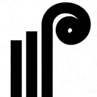

  

<h1 align="center">Caldrion</h1>

<strong>Permanent capital, put to work.</strong>

  <a href="https://www.caldrion.com">Website</a> ·
  <a href="https://www.caldrion.com/investments">Investments</a> ·
  <a href="https://ventures.caldrion.com">Caldrion Ventures</a> ·
  <a href="https://www.caldrion.com/careers">Careers</a> ·
  <a href="https://www.caldrion.com/contact">Contact</a>

---

Caldrion is a **single family office and principal investor**, with offices in New York and Sydney. We source,
underwrite, own and actively manage every investment ourselves, as operators rather than passive allocators, and we
invest permanent family capital from our own balance sheet.

### What we invest in

| Pillar | Focus |
| --- | --- |
| [Real Estate](https://www.caldrion.com/realestate) | Value-add multifamily, light industrial and specialty real estate in US markets |
| [Private Credit](https://www.caldrion.com/privatecredit) | First-lien senior secured loans: bridge, construction, asset-based and NAV lending |
| [Private Equity](https://www.caldrion.com/privateequity) | Lower middle market North American businesses: family successions, MBOs and carve-outs |
| [Digital Assets](https://www.caldrion.com/cryptocurrencies) | Proprietary strategies with institutional-grade custody |
| [Art & Collectibles](https://www.caldrion.com/artandcollectibles) | Post-war and contemporary art, collector cars, watches and fine wine, acquired by private treaty |
| [Venture Capital](https://ventures.caldrion.com) | Capital and company creation through Caldrion Ventures, our venture studio |

### What we build

Caldrion Ventures, our venture studio, builds and runs these products. Repositories are private to the organization.

| Product | What it is | Live | Repositories |
| --- | --- | --- | --- |
| Caldrion | The Caldrion LLC website | [www.caldrion.com](https://www.caldrion.com) | [caldrion-com](https://github.com/caldrion-com/caldrion-com) |
| Optimal Case | Compare Manhattan and Hamptons apartments by true cost, estimate cash to buy, test a property's numbers | [www.optimalcase.com](https://www.optimalcase.com) | [optimalcase-com](https://github.com/caldrion-com/optimalcase-com) · [optimalcase-apple](https://github.com/caldrion-com/optimalcase-apple) (iPhone, iPad, Android) |
| Fitness Jesus | Three real places to move in New York City, matched to mood, budget and neighbourhood | [www.fitnessjesus.com](https://www.fitnessjesus.com) | [fitnessjesus-com](https://github.com/caldrion-com/fitnessjesus-com) · [fitnessjesus-apple](https://github.com/caldrion-com/fitnessjesus-apple) (iPhone, Apple Watch) |
| DirectGay | A community for gay and bi guys: boards, guides, events, city guides and news | [directgay.com](https://directgay.com) | [directgay-com](https://github.com/caldrion-com/directgay-com) · [dg-apple](https://github.com/caldrion-com/dg-apple) (iPhone, Apple Watch, Android) |
| Slots at Sea | A guide to cruise ship casinos | [www.slotsatsea.com](https://www.slotsatsea.com) | [slotsatsea-com](https://github.com/caldrion-com/slotsatsea-com) · [slotsatsea-apple](https://github.com/caldrion-com/slotsatsea-apple) (iPhone, Apple Watch) |
| Inverth | Website of Inverth Commercial Holdings LLC, commercial property leasing across the US | [inverth.com](https://inverth.com) | [inverth-realestate-web](https://github.com/caldrion-com/inverth-realestate-web) |
| TechFusion Data Labs | Website of TechFusion's frontier forensics division | [techfusiondatalabs.com](https://techfusiondatalabs.com) | [techfusiondatalabs-com](https://github.com/caldrion-com/techfusiondatalabs-com) |
| Addicted2Fluffy | Official site of Fluffy, Upper East Side nightlife host | [addicted2fluffy.com](https://addicted2fluffy.com) | [addicted2fluffy-com](https://github.com/caldrion-com/addicted2fluffy-com) |
| CRM and Relay | The studio CRM (console, REST API, MCP server) and its iPhone, iPad and Apple Watch app | — | [crm](https://github.com/caldrion-com/crm) · [relay-apple](https://github.com/caldrion-com/relay-apple) |

**Studio platform:** [venture-template](https://github.com/caldrion-com/venture-template) (starting point for every venture: Hono + TypeScript on Cloudflare Workers, D1) ·
[studio-kit](https://github.com/caldrion-com/studio-kit) (shared measurement and security layer) ·
[coding-best-practices](https://github.com/caldrion-com/coding-best-practices) (how every repo is built) ·
[watchdog](https://github.com/caldrion-com/watchdog) (synthetic monitoring every 5 minutes) ·
[d1-backup](https://github.com/caldrion-com/d1-backup) (nightly D1 backups to R2).

### How we work

- **Issue forms.** Every repository uses the organization's issue forms: Bug, Feature, Task, Epic and Initiative. New bugs and feature requests start with `needs-triage`.
- **Hierarchy.** Work is organised with issue types and sub-issues: **Initiative** (a portfolio outcome over a quarter or more) › **Epic** (a shippable body of work) › **Feature / Task / Bug**. Blocking work is recorded as issue dependencies.
- **Project boards.** Each product has a GitHub Project with Status (Backlog, Ready, In progress, In review, Done), Priority (P0–P3), Size (XS–XL) and two-week iterations. Portfolio board: [Portfolio · Caldrion](https://github.com/orgs/caldrion-com/projects/14). Other boards include [Caldrion apps](https://github.com/orgs/caldrion-com/projects/1) · [caldrion.com website](https://github.com/orgs/caldrion-com/projects/2).
- **Pull requests** link their issue with `Closes #<n>` and follow the [pull request template](https://github.com/caldrion-com/.github/blob/main/.github/pull_request_template.md).

### Work with us

- **Have an opportunity?** [Submit it here](https://www.caldrion.com/contact).
- **Join us:** internships, MBA and graduate programs, and experienced roles at [caldrion.com/careers](https://www.caldrion.com/careers).
- **Follow us** on [LinkedIn](https://www.linkedin.com/company/caldrion).

### Contact

[www.caldrion.com/contact](https://www.caldrion.com/contact) for opportunities, partnerships and general enquiries. Please report security issues privately through the same page rather than in a public issue; see our [security policy](https://github.com/caldrion-com/.github/blob/main/SECURITY.md).

Caldrion is a single family office. Nothing here is an offer of securities or investment advice. See our
<a href="https://www.caldrion.com/disclosures">legal disclosures</a>.
